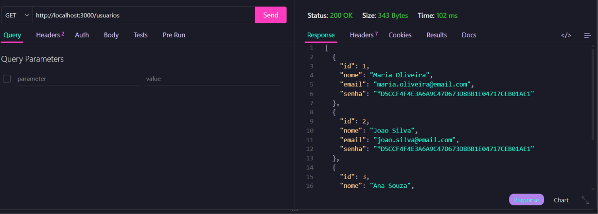
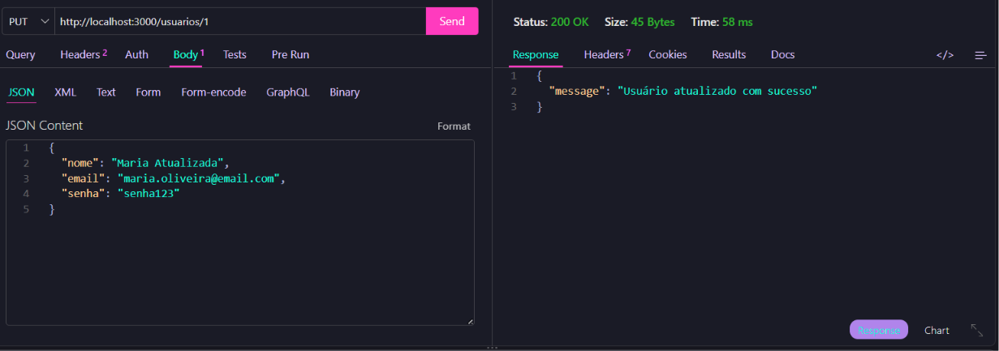
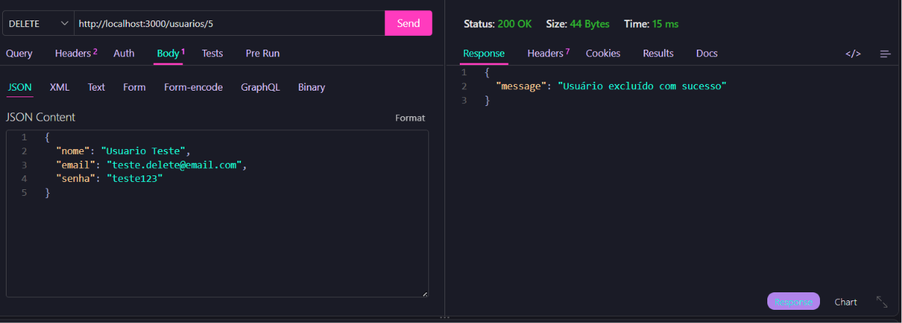
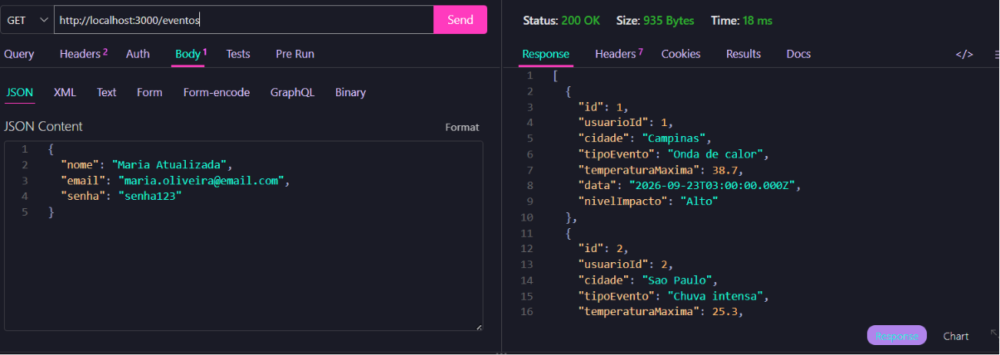
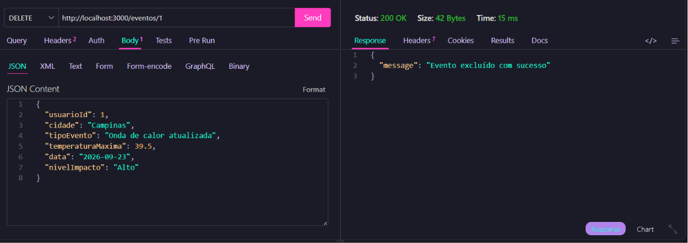
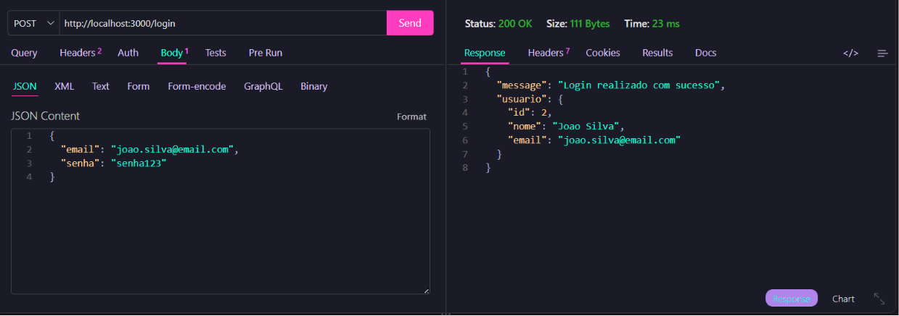
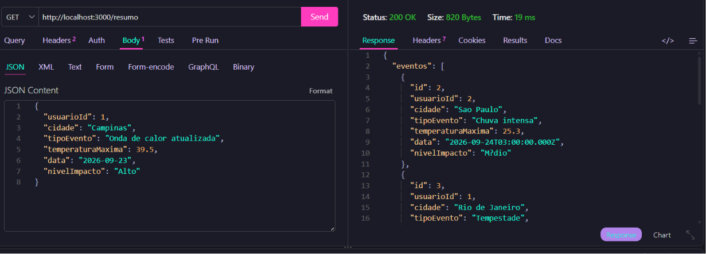

# Eventos Climáticos
O projeto Eventos Climáticos é uma API desenvolvida para cadastrar, consultar, atualizar e excluir usuários e eventos climáticos. Também permite realizar login e consultar um resumo dos eventos registrados, incluindo a média das temperaturas máximas.

O banco de dados utiliza duas entidades principais: Usuário e Evento, relacionadas por uma chave estrangeira.

# Diagrama Entidade-Relacionamento (DER)


# Diagrama de Classes


# Tecnologias Utilizadas

- Node.js 
- Express
- MySQL
- JavaScript
- Thunder Client

# Como executar o projeto

1. Abra a pasta do projeto no Visual Studio Code.
2. Abra o terminal integrado.
3. Instale as dependências:
```npm install```
4. Verifique se o banco de dados registros_climaticos está criado e se as configurações de conexão estão corretas no arquivo src/db.js.
5. Inicie o servidor utilizando o comando configurado no projeto. Se disponível, execute:
```npm run dev```
6. Com o servidor em execução, abra o Thunder Client para testar as rotas da API.

# Como Testar a API
Utilize o Thunder Client para enviar as requisições abaixo, considerando que o servidor esteja rodando em http://localhost:3000.

| Método | Rota | Descrição |
|---|---|---|
| GET | `/` | Verifica se o servidor funciona |
| POST | `/usuarios` | Cadastra um usuário |
| GET | `/usuarios` | Lista os usuários |
| PUT | `/usuarios/:id` | Atualiza um usuário |
| DELETE | `/usuarios/:id` | Exclui um usuário |
| POST | `/login` | Realiza o login |
| POST | `/eventos` | Cadastra um evento |
| GET | `/eventos` | Lista os eventos |
| PUT | `/eventos/:id` | Atualiza um evento |
| DELETE | `/eventos/:id` | Exclui um evento |
| GET | `/resumo` | Mostra os eventos e a média das temperaturas |

# Print dos testes - Thunder Client 

## Listar Usuários 


## Atualização de Usuário 



## Exclusão de Usuário 


## Listar Eventos Climáticos 


## Atualização de Evento Climático


## Exclusão de Evento Climático


## Login 


## Resumo dos Eventos


# sesi_pbe1_aula09_eventos_climaticos_2026
